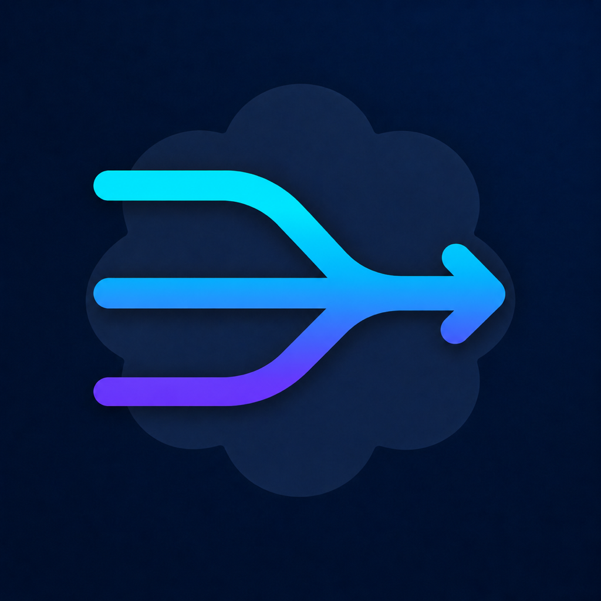
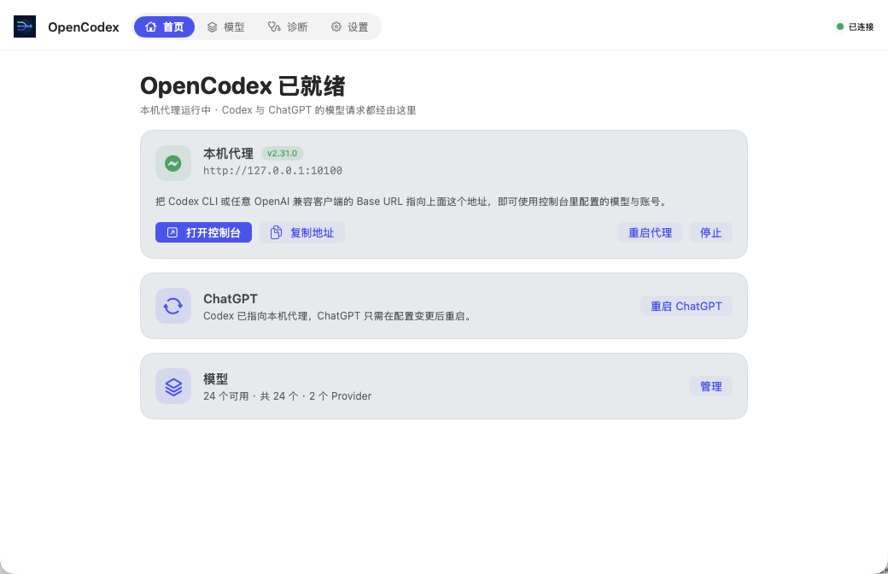

<p align="center">
  <a href="README.md">简体中文</a> · <strong>English</strong>
</p>

<div align="center">
  
  <h1>OpenCodex Desktop</h1>
  <p><strong>The everyday macOS control center for OpenCodex</strong></p>
  <p>Finish common configuration quickly on the desktop, then jump directly to the OpenCodex Console for advanced settings.</p>
  <p>
    
    
    <a href="LICENSE"></a>
  </p>
  <p>
    <a href="https://github.com/leeyang1990/opencodex-desktop/releases/latest"><strong>Download Latest</strong></a>
    · <a href="CONTRIBUTING.md">Contributing</a>
    · <a href="SECURITY.md">Security</a>
  </p>
</div>

---

OpenCodex Desktop is an independently developed community macOS client. It is not an OpenCodex source fork and does not bundle upstream source, account data, or Provider configuration. It handles native work such as Core lifecycle, diagnostics, and applying changes to ChatGPT, while also turning the most common account, channel, and subagent operations into shorter native workflows. The OpenCodex Console remains the complete interface for advanced parameters.

## Preview

<p align="center">
  
</p>
<p align="center"><sub>Real capture of an earlier version. The latest release has an updated layout.</sub></p>

## Highlights

- **Common account actions** — Add Codex accounts through the browser, inspect quota, switch the active account, or pause one. Credentials never pass through the client.
- **Simplified scheduling** — Choose quota, round-robin, or fill-first behavior; detailed priorities, cooldowns, and thresholds stay in the console.
- **Quick API channel setup** — Add, enable, disable, set default, and probe channels. Configure protocols, keys, automatic/manual model lists and private-network access. Advanced configuration opens the WebUI providers page.
- **Subagent preferences** — Choose up to five models and arrange their preference order; fallback and polling details stay in the console.
- **Usage overview** — Seven-day request, token and usage charts without reading request bodies.
- **Local proxy and ChatGPT** — Start, stop, copy the Base URL and restart ChatGPT. Explicit stop restores routing and then restarts ChatGPT if it is running.
- **Verified updates** — Check GitHub Releases, download the exact Apple Silicon DMG, and verify SHA-256 before opening it.
- **Online Core versions** — Settings fetches upstream stable releases with manual refresh and offline caching. Selections pin exact versions and digests, never automatically follow `latest`. Newly discovered releases are experimental and limited to Core 2.x with a launcher-pinned Bun runtime.

## Surfaces

Overview, Accounts, Channels, Subagents, and Settings share the main window's tab strip:

| Page | Contents |
| :--- | :--- |
| Overview | Proxy status, Base URL, ChatGPT restart and seven-day usage charts |
| Accounts | Add, inspect, switch, and pause accounts; choose a common scheduling strategy |
| Channels | Add, enable, disable, set default, probe, and add a key |
| Subagents | Select subagent models and arrange their preference order |
| Settings | Desktop preferences, startup options, Core versions and updates; access diagnostics and logs |

## Desktop and Console Responsibilities

| OpenCodex Desktop (shell) | OpenCodex Console (web, one click away) |
| :--- | :--- |
| Add/switch/pause accounts; choose a common scheduling strategy | Account priority, cooldown, removal, auto-switch and failover thresholds |
| Add/enable/probe channels, configure keys and model lists, choose the default | Full key-pool maintenance, deletion, custom models and routing |
| Subagent model selection/order and aggregate usage charts | Fallback policy, polling, detailed usage, logs, integrations, and experiments |
| Core lifecycle, diagnostics, updates, and ChatGPT restart | — |

Both interfaces operate on the same Core-owned configuration; Desktop keeps no parallel copy. The top-right Console button opens complete settings, while Advanced configuration in the add-channel form opens the providers page. Both use the default browser; unsaved form values are not forwarded.

## Download and Install

Requires macOS 14 or later. Builds are currently available for Apple Silicon (arm64) only.

The interface follows your macOS preferred language, including per-app language settings. English and Simplified Chinese are supported, with English as the fallback. Reopen the app after changing languages.

Download the DMG from [GitHub Releases](https://github.com/leeyang1990/opencodex-desktop/releases/latest) and drag the app into Applications; the ZIP is available for portable use. Releases use free ad-hoc signing and are not Apple-notarized, so the first launch may require right-clicking the app and choosing **Open**. Verify the SHA-256 attachment when possible.

## Behavior Boundaries

- Core is decoupled from the Desktop window after launch; quitting Desktop does not stop an already-running Core.
- Core does not start with Desktop by default. Starting Core with Desktop and launching Desktop at login are independent preferences.
- By default Desktop restores native Codex routing and restarts ChatGPT before quitting, so ChatGPT is not left pointing at a proxy that is about to disappear. The behavior can be turned off in **Settings › Client**.
- Desktop writes only a curated set of common settings through the Core's own endpoints. Fine-grained account scheduling, full channel and subagent parameters, custom models, routing, usage, and logs stay in the console.
- A channel API key lives in memory for the current session only, is written to the Core, and is then dropped; it never reaches preferences, the event log, or a log file, and the shell only reads back the Core's masked form. Codex sign-in opens the browser from the Core, so credentials never pass through the client.
- Both restore and re-point run through the Core's own recovery flow; Desktop never parses or rewrites `~/.codex/config.toml` itself. The next launch re-points Codex at the local proxy and offers a ChatGPT restart when the running app still holds the old configuration.
- To disable the proxy, choose **Stop**: stop Core, restore routing, then restart ChatGPT if it is running. This is not automatic crash recovery.
- Selecting a Codex CLI only specifies an executable for the Core process. It does not modify global `PATH`, terminal commands, or Codex accounts.
- Provider, account, and model configuration remains in a separate OpenCodex data directory and survives Core updates or removal.
- Desktop management requests connect only to loopback hosts.

## Local Development

Requires macOS 14+, Xcode Command Line Tools, and Swift 5.10+:

```bash
git clone https://github.com/leeyang1990/opencodex-desktop.git
cd opencodex-desktop
swift test
./scripts/check-source-quality.sh
./scripts/build-app.sh
```

The app bundle is written to `dist/OpenCodex Desktop.app`. See [CONTRIBUTING.md](CONTRIBUTING.md), the [architecture guide](docs/ARCHITECTURE.md), and the [Core API contract](docs/API_CONTRACT.md) for the complete development rules.

## Security and Privacy

- The management token is never sent to a non-loopback host.
- API keys, account identifiers, prompts, and request bodies are not written to the event timeline.
- Sanitized diagnostic bundles exclude credentials, account identifiers, request bodies, path inventories, and raw Core logs.
- Core, Bun, and client updates use pinned HTTPS URLs and exact digest verification.
- Generated apps, downloaded runtimes, configuration, credentials, and logs are excluded from Git.

Report vulnerabilities through GitHub private vulnerability reporting. Never include keys or unredacted configuration in a public issue.

## Acknowledgements and License

Thanks to the authors and contributors of [OpenCodex](https://github.com/lidge-jun/opencodex). This project is an independent community client, not an official OpenCodex distribution.

OpenCodex Desktop is released under the [MIT License](LICENSE). See [THIRD_PARTY_NOTICES.md](THIRD_PARTY_NOTICES.md) for third-party components and [CHANGELOG.md](CHANGELOG.md) for release history.
